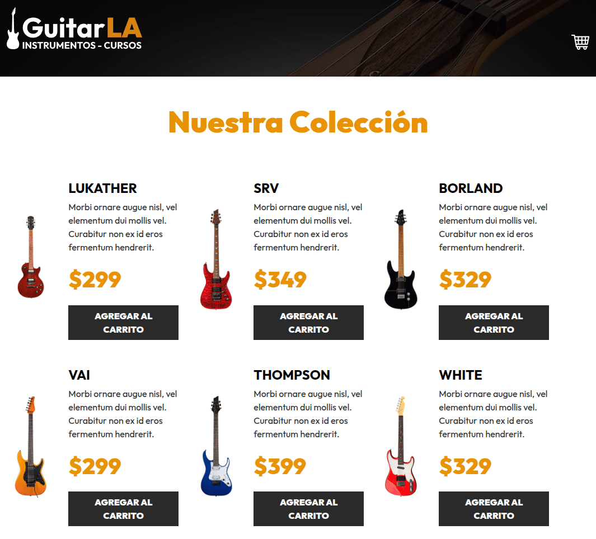
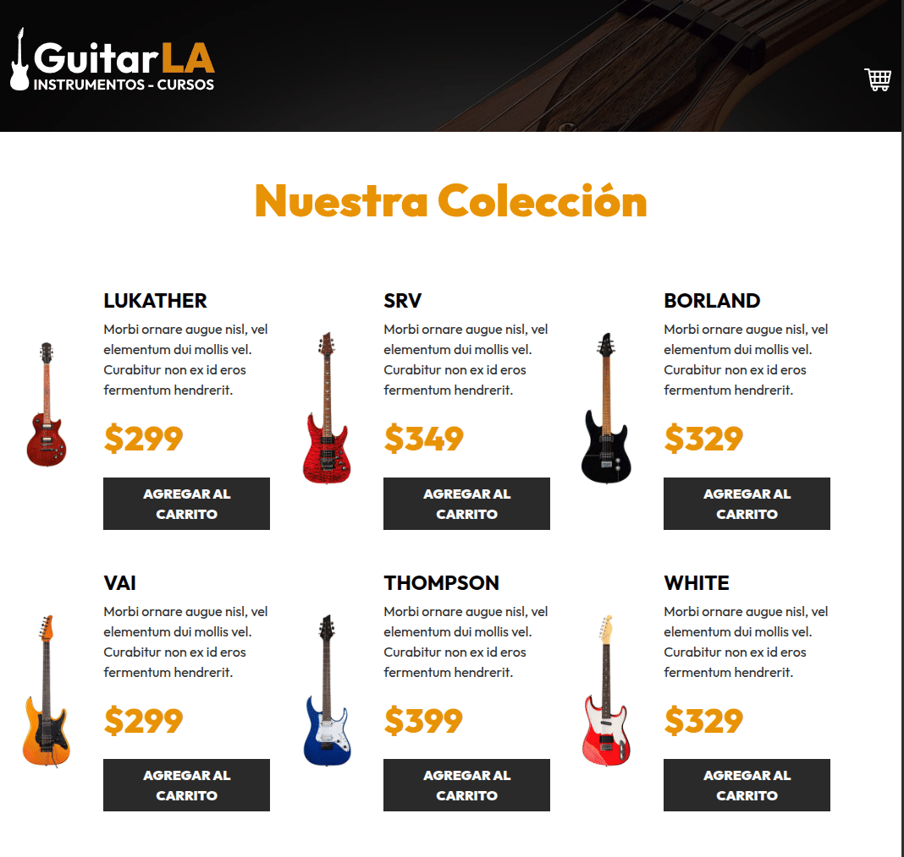

# 🎸 GuitarLA - React & TypeScript (Ruta MERN)

## 📽️ Demostración del Funcionamiento

| 🛒 Selección y Cantidades | 🗑️ Vaciar / Eliminar |
| :---: | :---: |
|  |  |

> **Nota:** La aplicación utiliza **Custom Hooks** (`useCart`) y **TypeScript Generics/Types** para centralizar la lógica de negocio y garantizar la seguridad de tipos en el flujo de datos.

**[🔗 Ver Demo en Vivo](https://pabloramirezcasas.github.io/guitarla-TS/)**


Este proyecto es una tienda virtual de guitarras y carrito de compras desarrollado con **React**, **TypeScript** y **Vite**, donde se aplican patrones avanzados de estado, tipado estricto y separación de responsabilidades como parte de la formación en el Stack MERN.

## 🚀 Funcionalidades

- **Gestión Dinámica del Carrito:** Agregar, incrementar, decrementar y eliminar productos del carrito en tiempo real.
- **Validación de Integridad:** Control de duplicados que incrementa automáticamente la cantidad si el elemento ya existe en el carrito.
- **Estado Derivado:** Cálculo automático e inmutable del total a pagar y evaluación del estado de la interfaz (carrito vacío/lleno).
- **Persistencia de Datos:** Almacenamiento y sincronización de los productos seleccionados mediante `localStorage`.

## 🛠️ Conceptos Técnicos Aplicados

- **Custom Hooks:** Extracción y encapsulamiento de la lógica del carrito en `useCart.ts` para mantener componentes limpios y reutilizables.
- **TypeScript & Type System:** Definición de interfaces y tipos (`Guitar`, `CartItem`) asegurando el autocompletado y previniendo errores en tiempo de desarrollo.
- **React State & Props:** Manejo eficiente del estado global de la aplicación mediante propagación de propiedades e inmutabilidad de datos.
- **Estilos:** Integración con **Bootstrap** para un diseño responsivo y adaptado a dispositivos móviles y escritorio.

## 💡 Aprendizajes Clave

El enfoque principal de este proyecto fue la migración de patrones de JavaScript hacia **TypeScript** y la creación de una arquitectura modular basada en **Custom Hooks**. Comprendí la importancia de desacoplar la lógica de estado de los componentes visuales (`Header.tsx`, `Guitar.tsx`), asegurando un código escalable, mantenible y fuertemente tipado para proyectos más complejos dentro de la Ruta MERN.

## 🔧 Instalación y Uso

1. Clona el repositorio:
      
```bash
git clone https://github.com/PabloRamirezCasas/guitarla-TS.git
